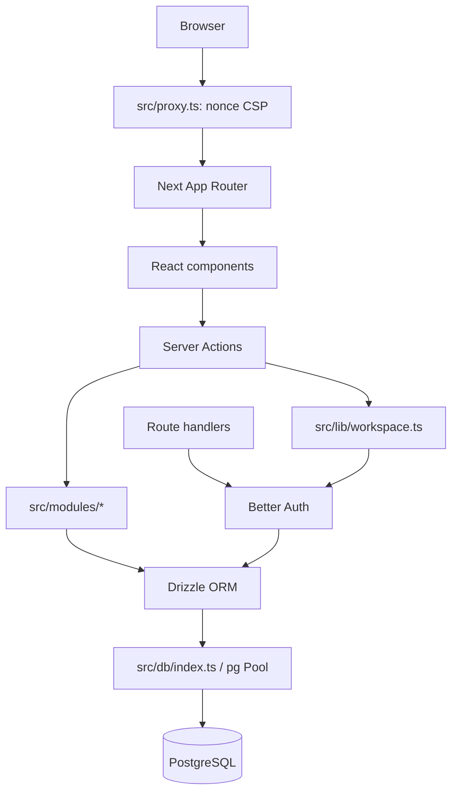

# Visão da arquitetura

## Contexto

Aplicação Next.js com App Router, execução server-first e PostgreSQL. A interface autenticada opera dentro de uma organização ativa. O servidor deriva usuário, organização e papel da sessão e das associações Better Auth; IDs recebidos do cliente são entradas, não evidência de autorização.

## Frontend e navegação

`src/app/(auth)` contém login; `src/app/(app)` agrupa páginas autenticadas e layout de workspace; `/workspace/select` trata seleção da organização. Componentes por domínio ficam em `src/components`. `src/app/layout.tsx` fornece o layout raiz e fontes/metadata; `globals.css` e Tailwind definem apresentação. O seletor de tema em `components/settings/theme-control.tsx` mantém estado de tema no cliente. Server Components leem dados para páginas; formulários/client controls submetem Server Actions ou chamam endpoints documentados no catálogo.

## Backend e domínio

As operações de clientes, contatos, negócios, tarefas, atividades, equipe e workspace estão em `src/modules/*`. Entradas são validadas com Zod antes das alterações. Operações de escrita relevantes executam transação Drizzle e registram `auditLogs`; consultas e mutations aplicam o `organizationId` da sessão. Route handlers ficam em `src/app/api`, incluindo Better Auth e exportações CSV. Erros tipados em `src/lib` convertem invariantes conhecidas em respostas controladas. `safe-logger.ts` usa allowlists e não serializa mensagens arbitrárias.

## Autenticação e autorização

`src/lib/auth.ts` instancia Better Auth com adaptador Drizzle, plugin de organizações, sessões em banco, cadastro público desativado no fluxo normal e cookies Secure quando `NODE_ENV=production`. `BETTER_AUTH_URL` fornece base URL e trusted origin. `src/lib/workspace.ts` valida sessão, memberships e papel, redirecionando páginas ou retornando erro JSON para API. As Server Actions revalidam autorização no servidor; esconder controles na interface não constitui controle de acesso.

## Dados e persistência

`src/db/schema/auth.ts` declara tabelas Better Auth e guarda interna de invariantes OWNER. `src/db/schema/crm.ts` declara entidades CRM, enums, relações e constraints de escopo/consistência. `src/db/index.ts` mantém pool `pg` e Drizzle como singleton no processo; em runtime usa `DATABASE_URL`. Em `CRM_TEST_MODE=1`, exige a URL local guardada em `TEST_DATABASE_URL`. Migrations SQL estão em `src/db/migrations`; para aplicá-las, o comando dedicado usa `DATABASE_URL_MIGRATIONS`, sem fallback para credencial runtime.

## Segurança observada

- `src/proxy.ts` gera nonce por GET/HEAD de documento e encaminha CSP para Next.js. Em produção a CSP é enforced; em desenvolvimento é report-only e permite apenas exceções de tooling local. `next.config.ts` define cabeçalhos básicos; não deve ser adicionado um segundo CSP incompatível no proxy de hospedagem.
- HTTPS público é requisito da implantação futura para cookies seguros; local HTTP existe para desenvolvimento.
- Escopo organizacional é verificado no servidor e reforçado por chaves estrangeiras compostas/constraints nas migrations.
- `src/lib/safe-logger.ts` limita campos/códigos e evita mensagens de erro e identificadores pessoais.
- Better Auth aplica rate limiting conforme configuração observada em `src/lib/auth.ts`; limites operacionais da hospedagem ainda precisam de verificação experimental.
- A suíte de integração contém testes de isolamento, RBAC, constraints, concorrência e auditoria; consultar DEPLOY-02/relatórios históricos para evidências datadas.

## Testes

Vitest separa `tests/unit` e `tests/integration` por configurações independentes. Helpers de integração verificam explicitamente o destino PostgreSQL local. Playwright cobre fluxos browser em `tests/e2e`; testes E2E podem precisar de browser e serviços descartáveis. [Guia de testes](../guides/testing.md).
